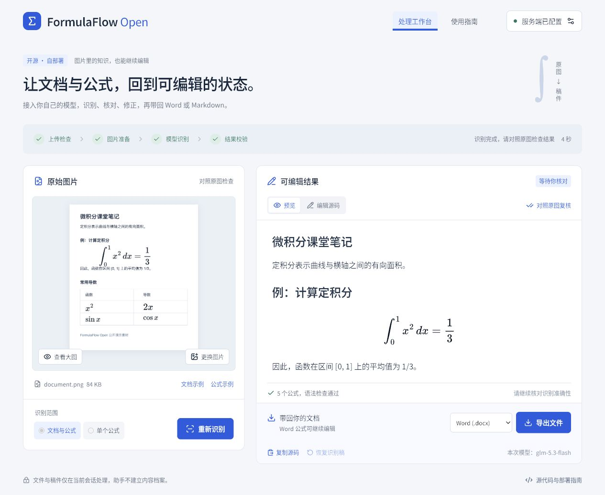
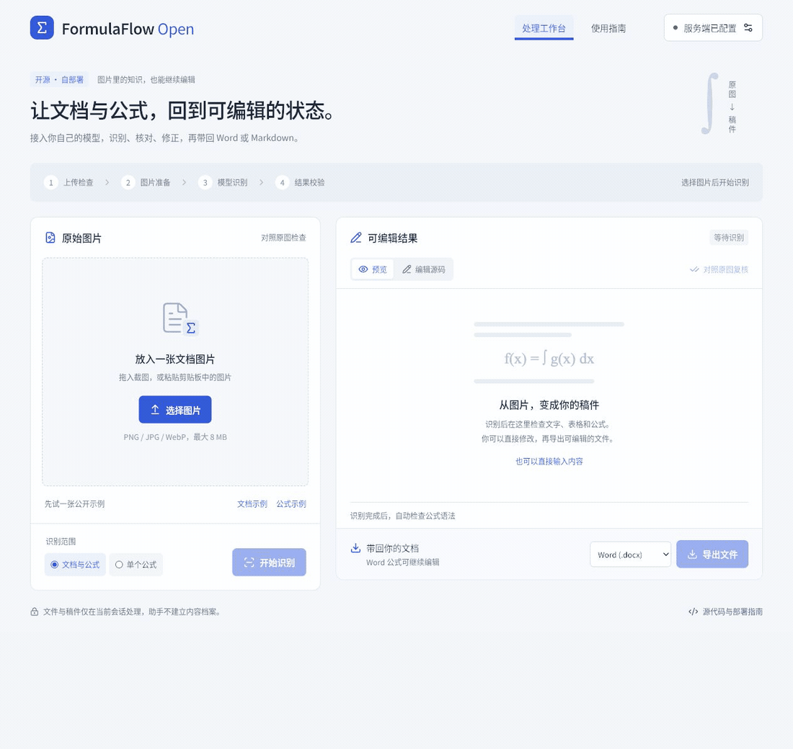
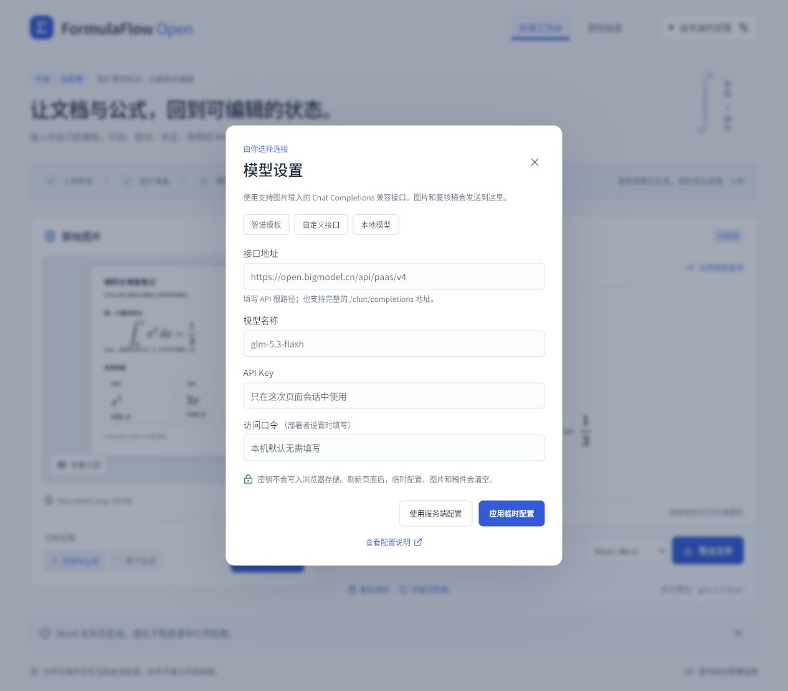
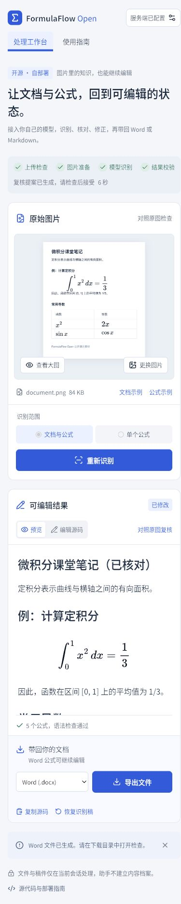

# FormulaFlow Open

**接入自己的模型，把图片中的文字、表格和公式变成可编辑稿件。**

基于 FormulaFlow 提取的开源文档与公式处理助手。可以独立运行，不需要账户、数据库或订阅服务。界面和文档以中文为主。



## 能做什么

- 上传、拖入或粘贴 PNG / JPG / WebP，支持文档与单个公式两种模式。
- 配置自己的 Chat Completions 兼容视觉模型；支持服务端配置、页面内临时配置，以及可访问的本地模型。
- 显示上传检查、图片准备、模型识别、结果校验的真实阶段和等待时间。可以取消，失败时有原因和处理方法。
- 对照原图编辑 Markdown / LaTeX，实时预览并检查公式语法。
- 使用模型对照原图复核；建议稿需要你明确接受，首次识别稿可以恢复。
- 导出可编辑 Word：文字是文字、表格是表格、公式是 Office 原生公式。文档还可导出 Markdown / JSON；单个公式还支持 LaTeX / MathML。

## 看一遍完整流程



演示使用仓库自制的公开课堂笔记图片。GIF 从实际页面操作截图生成，包含对照复核提案；模型计算等待片段有压缩；具体耗时与验证记录见 [验收报告](docs/verification/acceptance.md)。

[下载真实导出的可编辑 Word 示例](docs/verification/sample-output.docx) · [查看复核提案截图](docs/images/review.jpg)

## 本机启动

需要 **Node.js 22.12+**（推荐 Node.js 22 或 24）和 npm。

```bash
git clone https://github.com/19991621059/formulaflow-open.git
cd formulaflow-open
npm ci
cp .env.example .env.local
npm run dev
```

打开 [http://127.0.0.1:3000](http://127.0.0.1:3000)，点击右上角 **配置你的模型**，填写接口地址、API Key 和视觉模型名称。也可以编辑 `.env.local` 后重启，通过服务端配置使用。

接口地址示例 `https://your-provider.example/v1`，助手会补上 `/chat/completions`。需要模型支持 `image_url` 图片输入和文本输出；纯文本模型无法识别图片。智谱、本地 Ollama 与自定义接口的示例见 [模型配置](docs/configuration.md)。模板中的模型名称需要与自己的供应商账户或本地安装匹配。

配置入口不会进行额外模型调用；点击识别或复核后，才发送图片。模型使用费由你和供应商结算。

## 简单部署

### Node.js

```bash
npm ci
npm run build
npm start
```

默认仅监听本机。部署到服务器时可使用反向代理和 HTTPS；对外提供服务前设置 `APP_ACCESS_TOKEN`。详见 [部署说明](docs/deployment.md)。

### Docker Compose

```bash
cp .env.example .env.local
# 编辑模型配置；环境文件不会进入镜像构建上下文。
docker compose up --build -d
```

默认通过 [http://127.0.0.1:3000](http://127.0.0.1:3000) 访问。Docker 中的 `127.0.0.1` 是容器自身；连接主机模型时请按 [部署说明](docs/deployment.md) 配置地址。

## 使用步骤

1. 选择图片和识别范围。整页内容使用「文档与公式」，裁剪后的数学表达式使用「单个公式」。
2. 开始识别，查看阶段和等待时间。失败提示会区分配置、网络、密钥、额度、限流、超时和输出截断等原因。
3. 核对原图。在「编辑源码」中修正；数学语法通过不代表识别内容正确。
4. 如需模型复核，选择「对照原图复核」，检查提案后接受或保留自己的稿件。
5. 选择格式导出，再在 Word / WPS 等编辑器中打开检查。




## 数据与边界

- 密钥只在服务端环境文件或当前页面内存中使用，不写入浏览器存储；临时配置刷新后清空。
- 上传图片和稿件在当前请求及页面会话内处理，助手不写内容数据库或上传档案。发送模型前会重新解码图片并去除 EXIF / GPS 等元数据。
- 图片和复核稿会发送到你配置的供应商。供应商、反向代理和托管平台的数据政策需要自行确认。
- 刷新页面会清空未导出的稿件，请及时导出。取消请求可能无法撤销供应商已开始的计算或计费。
- 当前支持单张静态图片，最大 8 MB、边长 10,000 像素、总面积 4,000 万像素。暂不支持 PDF 直传、多页批量、OCR 坐标标注和多人账户管理。
- Word 导出保留语义内容、表格和可编辑公式，不承诺还原扫描件的原始分页、字体和排版。少数复杂 TeX 结构可能需要简化后再导出。
- 接口兼容性取决于供应商。已验证的路径、失败测试和剩余边界以 [验收报告](docs/verification/acceptance.md) 为准。

## 开发与验证

```bash
npm run typecheck
npm test
npm run build
npm run test:e2e
npm run check:secrets
npm audit --omit=dev
```

`test:e2e` 使用明确标记的本地测试模型接口，验证上传、阶段事件、编辑、复核、导出和错误处理。**它不证明真实 OCR。**

真实模型检查需要先启动已配置的应用，再运行：

```bash
# 默认检查 http://127.0.0.1:3476；可改为你的启动端口。
LIVE_APP_URL=http://127.0.0.1:3000 npm run test:live
```

此命令发送两张公开示例图片，可能产生模型费用；结果保存到 Git 忽略的 `outputs/live/`。受保护部署需在命令环境中传入 `APP_ACCESS_TOKEN`。

项目结构与贡献方式见 [贡献指南](CONTRIBUTING.md)。安全问题请参阅 [SECURITY.md](SECURITY.md)。

## 许可证

应用源码采用 [MIT](LICENSE)。依赖和 Source Han Sans CN 字体保留原许可证，包含 LGPL-3.0-or-later 的服务端转换依赖；详见 [第三方说明](THIRD_PARTY_NOTICES.md)。
